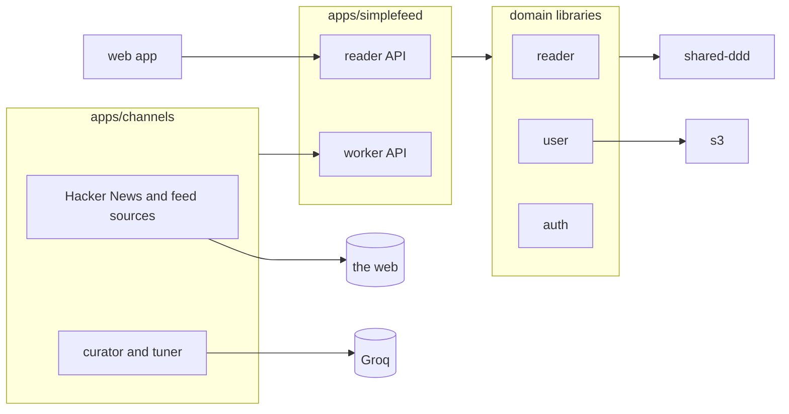

# simplefeed-backend

The backend of simplefeed, a news reader with AI curation. You subscribe to **channels**, such as Hacker News or any RSS or Atom feed, and each channel picks the stories you'll care about. You tune a channel by chatting with it ("mute crypto", "more rust"), and your likes show it what you want more of. Every reader has their own preferences, read state, likes and saved items.

The frontend is [simplefeed-frontend](https://github.com/edgarmueller/simplefeed-frontend).

## Stack

- [NestJS](https://nestjs.com) 12
- PostgreSQL with TypeORM, schema managed by migrations
- A separate worker (`apps/channels`) for fetching feeds and calling the model
- Optional curation with a model on [Groq](https://groq.com)
- S3-compatible storage for avatars (optional)
- Nx monorepo, Vitest, ESLint with enforced module boundaries

## Architecture



The application in `apps/simplefeed` is a thin adapter layer: HTTP controllers and DTOs. The domain logic lives in `libs/`.

| Library      | Responsibility                                                                 |
| ------------ | ------------------------------------------------------------------------------ |
| `reader`     | Channels, their items, subscriptions with preferences, entries and tuning chats |
| `user`       | Accounts and profiles                                                          |
| `auth`       | Registration, login, JWT access and refresh tokens                             |
| `s3`         | Uploading public files                                                         |
| `shared-ddd` | Aggregate root base class, domain event publishing, pagination helpers         |

`eslint.config.mjs` enforces the layering through project tags. The apps may depend on anything. Domain libraries may depend on other domain libraries, `s3` and `shared-ddd`. `s3` and `shared-ddd` depend on nothing else in the repo.

### The reader model

| Concept           | What it is                                                                                          |
| ----------------- | --------------------------------------------------------------------------------------------------- |
| **Channel**       | A source: Hacker News, built in, or a feed someone added. A feed is pending until the worker read it. |
| **Item**          | A story from a channel, stored once however many readers get it.                                    |
| **Subscription**  | A reader following a channel, with their own preferences: interests, muted topics, limits, notes.   |
| **Entry**         | An item a channel picked for one reader, with a summary and the reader's read, liked and saved state. |
| **Tuning message** | The chat between a reader and a channel. The worker answers and updates the subscription's preferences. |

The reader's feed is their entries, newest first. Read state, "mark all as read", likes and saved items all belong to entries, so they are per reader.

## The channels worker

`apps/channels` does everything that reaches out to the web or a model. It talks to the API only through the worker endpoints (`/api/worker/…`), authenticated with `WORKER_API_KEY`, and keeps no state of its own:

- **Fetching and picking**, every hour (`CHANNELS_POST_INTERVAL_MINUTES`). For each active channel it fetches the latest stories and stores them as items. Then, for each subscriber, it picks up to three new items from the last 48 hours (a week for feeds), within the reader's daily limit, and adds them to the reader's feed.
- **Picking for new subscribers**, every 10 seconds. A subscription that hasn't got anything yet gets picks right away, so a new reader doesn't wait an hour.
- **Reading new feeds**, every 10 seconds (`CHANNELS_FEED_INTERVAL_SECONDS`). Users add a feed's URL or a website's (`POST /api/channels`). The worker looks for the feed: the URL itself, a feed the page links to with `<link rel="alternate">`, or a common path such as `/feed`. It then activates the channel with the feed's title, or marks it failed with the reason. Two addresses that lead to the same feed share one channel, and adding a failed feed again retries it.
- **Answering chats**, every 5 seconds (`CHANNELS_CHAT_INTERVAL_SECONDS`). It turns a reader's message into updated preferences and a reply.

**How picking works:** with `GROQ_API_KEY` set, a model picks and summarizes the items, taking the reader's preferences, notes and liked items into account, and interprets free-form chat requests. Without a key, or when the model fails, the worker uses rules:
- muted topics are left out
- the reader's interests come first, then items that share keywords with items they liked
- after that, items are ranked by score, or newest first for feeds

Chat then understands a fixed set of commands. The model sits behind a small interface (`JsonModel`), so another provider takes one adapter.

**Fetch safety:** user-supplied URLs are fetched only over http(s). Hosts on private networks are refused, checked on every redirect, and requests are limited in time and size.

## Getting started

You need Node 22 and Docker.

```sh
npm install
npm run infra:up   # Postgres, a test Postgres and LocalStack (S3)
npm run dev        # http://localhost:5001/api
```

Pending migrations run automatically when the server starts.

To fetch and pick stories, start the worker in a second terminal:

```sh
npm run dev:channels
```

To curate with a model, put a free [Groq API key](https://console.groq.com/keys) in `.env.local` as `GROQ_API_KEY`.

Default settings for local development live in `.env`. Put personal overrides in a `.env.local` file, which git ignores. Nx loads both automatically.

### Checks

```sh
npm run typecheck
npm run lint
npm test           # unit tests plus API tests against the test database on port 5433
```

The API tests in `apps/simplefeed` boot the whole application and talk to it over HTTP, both as a reader and as the worker.

## Configuration

| Variable                                                                                    | Description                                                                                                     |
| ------------------------------------------------------------------------------------------- | --------------------------------------------------------------------------------------------------------------- |
| `DATABASE_URL`                                                                              | Postgres connection string                                                                                      |
| `DATABASE_SSL`                                                                              | `true` to connect over TLS                                                                                      |
| `PORT`                                                                                      | HTTP port (default `3333`)                                                                                      |
| `CORS_ORIGINS`                                                                              | Comma-separated list of allowed origins                                                                         |
| `JWT_ACCESS_TOKEN_SECRET`, `JWT_REFRESH_TOKEN_SECRET`                                       | Token signing secrets                                                                                           |
| `JWT_ACCESS_TOKEN_EXPIRATION_IN_SECONDS`, `JWT_REFRESH_TOKEN_EXPIRATION_IN_SECONDS`         | Token lifetimes (defaults 300 and 3600)                                                                         |
| `USE_COOKIES`                                                                               | Experimental: read tokens from cookies instead of the `Authorization` header. Login doesn't set the cookies yet |
| `S3_ENABLED`                                                                                | `true` to store avatars in S3. When it's off, uploads are ignored                                               |
| `S3_ENDPOINT`, `S3_BUCKET_NAME`, `AWS_REGION`, `AWS_ACCESS_KEY_ID`, `AWS_SECRET_ACCESS_KEY` | S3 settings, required only when S3 is enabled                                                                   |
| `WORKER_API_KEY`                                                                            | Shared secret for the worker endpoints. They are closed without it                                              |

The channels worker reads:

| Variable                                    | Description                                                                           |
| ------------------------------------------- | ------------------------------------------------------------------------------------- |
| `WORKER_API_KEY`                            | Same value as the API's                                                               |
| `CHANNELS_API_URL`                          | Where the API runs (default `http://localhost:5001/api`)                              |
| `GROQ_API_KEY`, `GROQ_MODEL`                | Optional model for curating and chat (default model `openai/gpt-oss-20b`)             |
| `CHANNELS_POST_INTERVAL_MINUTES`            | How often channels fetch and pick (60)                                                |
| `CHANNELS_FEED_INTERVAL_SECONDS`            | How often the worker reads new feeds and picks for new subscribers (10)               |
| `CHANNELS_CHAT_INTERVAL_SECONDS`            | How often the worker answers chat messages (5)                                        |
| `HACKER_NEWS_API_URL`                       | Defaults to the official API                                                          |
| `CHANNELS_ALLOW_PRIVATE_FEED_HOSTS`         | `true` lets users add feeds on private networks, e.g. localhost; only for development |

## Database migrations

After changing an entity schema, generate a migration against a database that is up to date:

```sh
npm run migration:generate --name=add-something
```

Then add the new class to `apps/simplefeed/src/migrations/index.ts`. Migrations are bundled into the build, so each one has to be listed there.

## Deployment

`fly.toml` deploys the Docker image to [fly.io](https://fly.io) with `fly deploy`. The image contains the API and the channels worker, which run as two process groups. Set secrets with `fly secrets set KEY=value`, including `WORKER_API_KEY` and optionally `GROQ_API_KEY`. The image installs only the runtime dependencies that each build emits next to its bundle.

## Status

This is a demo project, not a finished product. There is no rate limiting, no email verification, and cookie-based auth is unfinished. Test coverage focuses on the main API flows rather than on every edge case.
