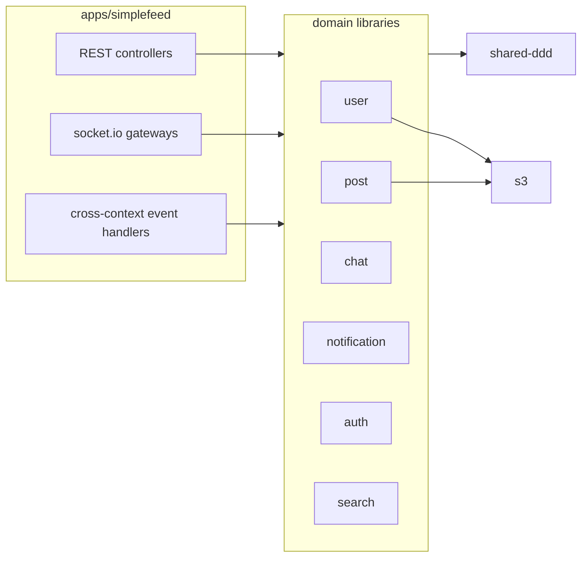

# simplefeed-backend

The backend of a small social network: profiles, friend requests, a feed with likes and threaded comments, 1:1 chat, and real-time notifications.

It started as a playground for domain-driven design with NestJS. Each bounded context lives in its own library, and the contexts talk to each other through domain events instead of calling each other directly.

The frontend is [simplefeed-frontend](https://github.com/edgarmueller/simplefeed-frontend).

## Stack

- [NestJS](https://nestjs.com) 12 with CQRS-style domain events (`@nestjs/cqrs`)
- PostgreSQL with TypeORM, schema managed by migrations
- socket.io for chat and notifications, with a Redis adapter so several instances can share rooms
- S3-compatible storage for avatars and post images (optional)
- Nx monorepo, Vitest, ESLint with enforced module boundaries

## Architecture



The application in `apps/simplefeed` is a thin adapter layer: HTTP controllers, websocket gateways, DTOs, and the event handlers that connect one context to another. The domain logic lives in `libs/`.

| Library        | Responsibility                                                         |
| -------------- | ---------------------------------------------------------------------- |
| `user`         | Users, profiles, friendships and friend requests                       |
| `post`         | Posts, likes and comment threads (materialized paths via `ltree`)      |
| `chat`         | Conversations and messages                                             |
| `notification` | Notifications and their read state                                     |
| `auth`         | Registration, login, JWT access and refresh tokens                     |
| `search`       | User search by name                                                    |
| `s3`           | Uploading public files                                                 |
| `shared-ddd`   | Aggregate root base class, domain event publishing, pagination helpers |

`eslint.config.mjs` enforces the layering through project tags. The app may depend on anything. Domain libraries may depend on other domain libraries, `s3` and `shared-ddd`. `s3` and `shared-ddd` depend on nothing else in the repo.

### Domain events

Aggregates record events when their state changes. For example, `post.like(user)` records a `PostLikedEvent`. The repository that saves the aggregate publishes those events once the surrounding transaction commits (`DomainEvents.publishOnCommit`), so handlers never react to changes that end up rolled back.

| Event                   | Handled by                                                          |
| ----------------------- | ------------------------------------------------------------------- |
| `FriendRequestSent`     | notification for the recipient                                      |
| `FriendRequestAccepted` | notification for the sender, and a new conversation between both    |
| `PostCreatedEvent`      | notification when posting to someone else's feed                    |
| `PostLikedEvent`        | notification for the author, and an updated like count              |
| `CommentAddedEvent`     | notification for the post author or for the parent comment's author |
| `UserClosedEvent`       | conversations of the user are soft-deleted                          |
| `UserReactivatedEvent`  | conversations of the user are restored                              |
| `NotificationCreated`   | pushed to the recipient over the `/notifications` socket            |

## Getting started

You need Node 22 and Docker.

```sh
npm install
npm run infra:up   # Postgres, a test Postgres, Redis and LocalStack (S3)
npm run dev        # http://localhost:5001/api
```

Pending migrations run automatically when the server starts.

Default settings for local development live in `.env`. Put personal overrides in a `.env.local` file, which git ignores. Nx loads both automatically.

### Checks

```sh
npm run typecheck
npm run lint
npm test           # unit tests plus API tests against the test database on port 5433
```

The API tests in `apps/simplefeed` boot the whole application and talk to it over HTTP and socket.io, the same way the frontend does.

## Configuration

| Variable                                                                                    | Description                                                                                                     |
| ------------------------------------------------------------------------------------------- | --------------------------------------------------------------------------------------------------------------- |
| `DATABASE_URL`                                                                              | Postgres connection string                                                                                      |
| `DATABASE_SSL`                                                                              | `true` to connect over TLS                                                                                      |
| `REDIS_URL`                                                                                 | Redis used by the socket.io adapter                                                                             |
| `PORT`                                                                                      | HTTP port (default `3333`)                                                                                      |
| `CORS_ORIGINS`                                                                              | Comma-separated list of allowed origins                                                                         |
| `JWT_ACCESS_TOKEN_SECRET`, `JWT_REFRESH_TOKEN_SECRET`                                       | Token signing secrets                                                                                           |
| `JWT_ACCESS_TOKEN_EXPIRATION_IN_SECONDS`, `JWT_REFRESH_TOKEN_EXPIRATION_IN_SECONDS`         | Token lifetimes (defaults 300 and 3600)                                                                         |
| `USE_COOKIES`                                                                               | Experimental: read tokens from cookies instead of the `Authorization` header. Login doesn't set the cookies yet |
| `S3_ENABLED`                                                                                | `true` to store uploads in S3. When it's off, uploads are ignored                                               |
| `S3_ENDPOINT`, `S3_BUCKET_NAME`, `AWS_REGION`, `AWS_ACCESS_KEY_ID`, `AWS_SECRET_ACCESS_KEY` | S3 settings, required only when S3 is enabled                                                                   |

## Database migrations

After changing an entity schema, generate a migration against a database that is up to date:

```sh
npm run migration:generate --name=add-something
```

Then add the new class to `apps/simplefeed/src/migrations/index.ts`. Migrations are bundled into the build, so each one has to be listed there.

## Deployment

`fly.toml` deploys the Docker image to [fly.io](https://fly.io) with `fly deploy`. Set secrets with `fly secrets set KEY=value`. The image installs only the runtime dependencies that the build emits next to the bundle.

## Status

This is a demo project, not a finished product. There is no rate limiting, no email verification, and no moderation, and cookie-based auth is unfinished. Test coverage focuses on the main API flows rather than on every edge case.
