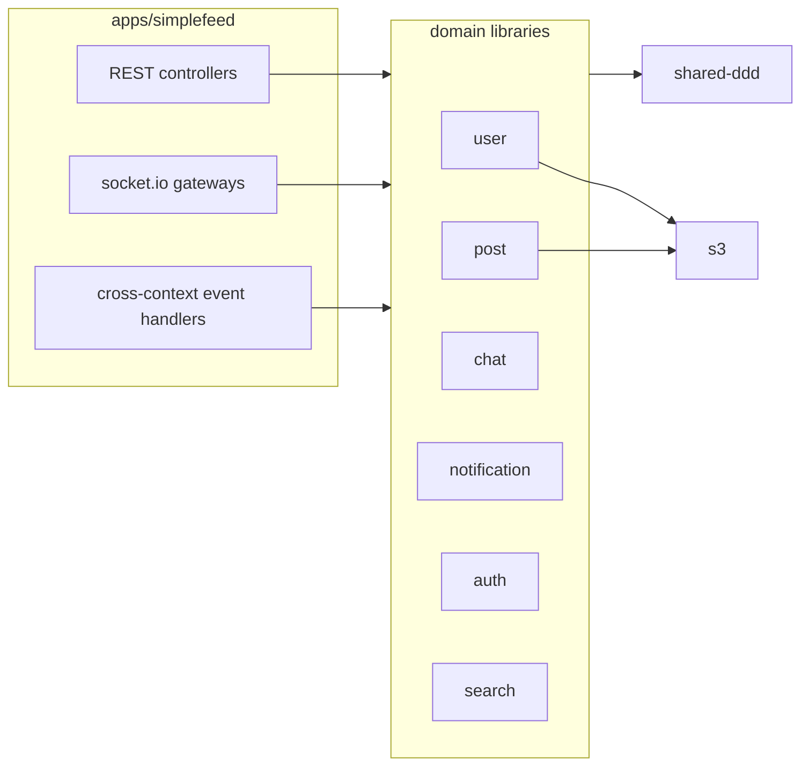

# simplefeed-backend

The backend of a small social network: profiles, friend requests, a feed with likes and threaded comments, 1:1 chat, and real-time notifications. News **channels** post into the same feed, and you tune each one by chatting with it.

It started as a playground for domain-driven design with NestJS. Each bounded context lives in its own library, and the contexts talk to each other through domain events instead of calling each other directly.

The frontend is [simplefeed-frontend](https://github.com/edgarmueller/simplefeed-frontend).

## Stack

- [NestJS](https://nestjs.com) 12 with CQRS-style domain events (`@nestjs/cqrs`)
- PostgreSQL with TypeORM, schema managed by migrations
- socket.io for chat and notifications, with a Redis adapter so several instances can share rooms
- S3-compatible storage for avatars and post images (optional)
- Nx monorepo, Vitest, ESLint with enforced module boundaries

## Architecture



The application in `apps/simplefeed` is a thin adapter layer: HTTP controllers, websocket gateways, DTOs, and the event handlers that connect one context to another. The domain logic lives in `libs/`.

| Library        | Responsibility                                                         |
| -------------- | ---------------------------------------------------------------------- |
| `user`         | Users, profiles, friendships and friend requests                       |
| `post`         | Posts, likes and comment threads (materialized paths via `ltree`)      |
| `chat`         | Conversations and messages                                             |
| `notification` | Notifications and their read state                                     |
| `auth`         | Registration, login, JWT access and refresh tokens                     |
| `search`       | User search by name                                                    |
| `s3`           | Uploading public files                                                 |
| `shared-ddd`   | Aggregate root base class, domain event publishing, pagination helpers |

`eslint.config.mjs` enforces the layering through project tags. The app may depend on anything. Domain libraries may depend on other domain libraries, `s3` and `shared-ddd`. `s3` and `shared-ddd` depend on nothing else in the repo.

### Domain events

Aggregates record events when their state changes. For example, `post.like(user)` records a `PostLikedEvent`. The repository that saves the aggregate publishes those events once the surrounding transaction commits (`DomainEvents.publishOnCommit`), so handlers never react to changes that end up rolled back.

| Event                   | Handled by                                                          |
| ----------------------- | ------------------------------------------------------------------- |
| `FriendRequestSent`     | notification for the recipient                                      |
| `FriendRequestAccepted` | notification for the sender, and a new conversation between both    |
| `PostCreatedEvent`      | notification when posting to someone else's feed                    |
| `PostLikedEvent`        | notification for the author, and an updated like count              |
| `CommentAddedEvent`     | notification for the post author or for the parent comment's author |
| `UserClosedEvent`       | conversations of the user are soft-deleted                          |
| `UserReactivatedEvent`  | conversations of the user are restored                              |
| `NotificationCreated`   | pushed to the recipient over the `/notifications` socket            |

## Channels

Channels are bot accounts that post news. `apps/channels` is a separate worker that runs them. It uses only the public API and the chat socket, the same way the web app does, so the backend just sees users:

- **Subscribing** is a friend request, which the channel accepts automatically. Its posts then show up in your feed.
- **Tuning** happens in the chat with the channel: "mute crypto", "more rust", "max 5 per day", or with a model configured, plain requests such as "fewer AI stories and nothing paywalled". The channel answers with its updated settings.

The first channel is **Hacker News**. Every hour it reads the front page from the [official API](https://github.com/HackerNews/API), skips stories that are too old, below your minimum score or already posted, and posts up to three new ones within your daily limit.

With `GROQ_API_KEY` set, a model on [Groq](https://groq.com) picks and summarizes the stories and interprets chat requests. Without a key, or when the model fails, the channel uses rules instead: muted topics are left out, your interests come first, and then stories are ranked by score. Chat then understands a fixed set of commands. The model sits behind a small interface (`JsonModel`), so another provider takes one adapter.

Bot accounts can only be created with `BOT_REGISTRATION_KEY`. Channel state (preferences, posted items) lives in its own `channels` schema.

## Getting started

You need Node 22 and Docker.

```sh
npm install
npm run infra:up   # Postgres, a test Postgres, Redis and LocalStack (S3)
npm run dev        # http://localhost:5001/api
```

Pending migrations run automatically when the server starts.

To run the channels as well, start the worker in a second terminal:

```sh
npm run dev:channels
```

It creates its accounts on first start. To curate with a model, put a free [Groq API key](https://console.groq.com/keys) in `.env.local` as `GROQ_API_KEY`.

Default settings for local development live in `.env`. Put personal overrides in a `.env.local` file, which git ignores. Nx loads both automatically.

### Checks

```sh
npm run typecheck
npm run lint
npm test           # unit tests plus API tests against the test database on port 5433
```

The API tests in `apps/simplefeed` boot the whole application and talk to it over HTTP and socket.io, the same way the frontend does.

## Configuration

| Variable                                                                                    | Description                                                                                                     |
| ------------------------------------------------------------------------------------------- | --------------------------------------------------------------------------------------------------------------- |
| `DATABASE_URL`                                                                              | Postgres connection string                                                                                      |
| `DATABASE_SSL`                                                                              | `true` to connect over TLS                                                                                      |
| `REDIS_URL`                                                                                 | Redis used by the socket.io adapter                                                                             |
| `PORT`                                                                                      | HTTP port (default `3333`)                                                                                      |
| `CORS_ORIGINS`                                                                              | Comma-separated list of allowed origins                                                                         |
| `JWT_ACCESS_TOKEN_SECRET`, `JWT_REFRESH_TOKEN_SECRET`                                       | Token signing secrets                                                                                           |
| `JWT_ACCESS_TOKEN_EXPIRATION_IN_SECONDS`, `JWT_REFRESH_TOKEN_EXPIRATION_IN_SECONDS`         | Token lifetimes (defaults 300 and 3600)                                                                         |
| `USE_COOKIES`                                                                               | Experimental: read tokens from cookies instead of the `Authorization` header. Login doesn't set the cookies yet |
| `S3_ENABLED`                                                                                | `true` to store uploads in S3. When it's off, uploads are ignored                                               |
| `S3_ENDPOINT`, `S3_BUCKET_NAME`, `AWS_REGION`, `AWS_ACCESS_KEY_ID`, `AWS_SECRET_ACCESS_KEY` | S3 settings, required only when S3 is enabled                                                                   |
| `BOT_REGISTRATION_KEY`                                                                      | Shared secret that lets the channels worker create bot accounts. Bot registration is off without it             |

The channels worker reads:

| Variable                                                                   | Description                                                               |
| -------------------------------------------------------------------------- | ------------------------------------------------------------------------- |
| `DATABASE_URL`                                                             | Postgres for the worker's own state, in the `channels` schema             |
| `BOT_REGISTRATION_KEY`                                                     | Same value as the API's                                                   |
| `CHANNEL_PASSWORD`                                                         | Password for the channel accounts                                         |
| `CHANNELS_API_URL`, `CHANNELS_SOCKET_URL`                                  | Where the API runs (defaults `http://localhost:5001/api` and `…:5001`)    |
| `GROQ_API_KEY`, `GROQ_MODEL`                                               | Optional model for curating and chat (default model `openai/gpt-oss-20b`) |
| `CHANNELS_POST_INTERVAL_MINUTES`, `CHANNELS_SUBSCRIPTION_INTERVAL_SECONDS` | How often channels post (60) and check for subscribers and messages (30)  |
| `HACKER_NEWS_API_URL`                                                      | Defaults to the official API                                              |

## Database migrations

After changing an entity schema, generate a migration against a database that is up to date:

```sh
npm run migration:generate --name=add-something
```

Then add the new class to `apps/simplefeed/src/migrations/index.ts`. Migrations are bundled into the build, so each one has to be listed there.

## Deployment

`fly.toml` deploys the Docker image to [fly.io](https://fly.io) with `fly deploy`. The image contains the API and the channels worker, which run as two process groups. Set secrets with `fly secrets set KEY=value`, including `BOT_REGISTRATION_KEY`, `CHANNEL_PASSWORD` and optionally `GROQ_API_KEY`. The image installs only the runtime dependencies that each build emits next to its bundle.

## Status

This is a demo project, not a finished product. There is no rate limiting, no email verification, and no moderation, and cookie-based auth is unfinished. Test coverage focuses on the main API flows rather than on every edge case.
